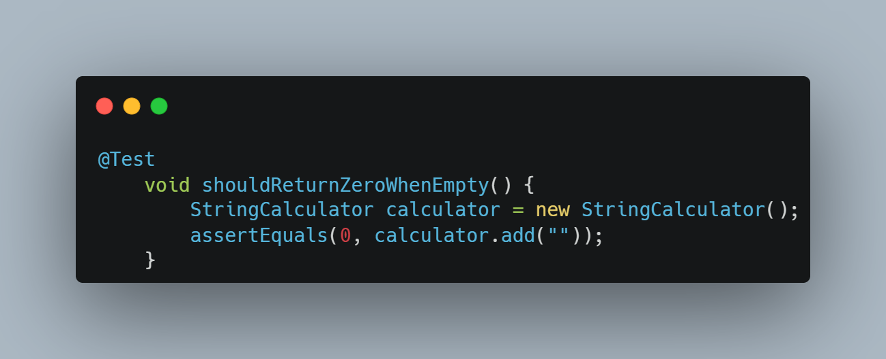
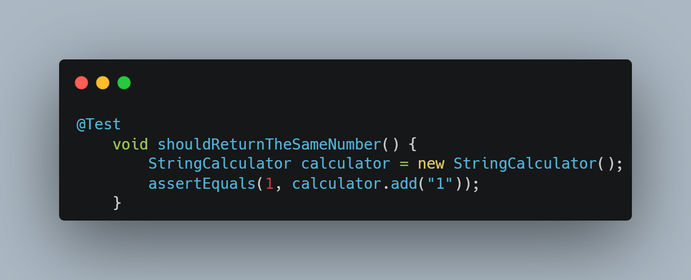
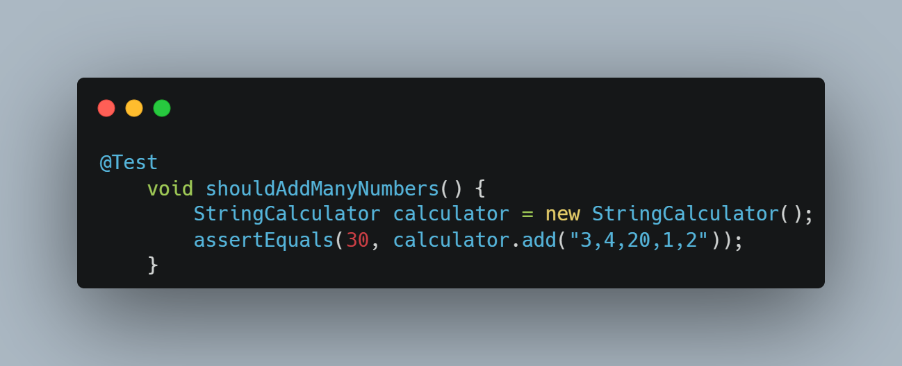
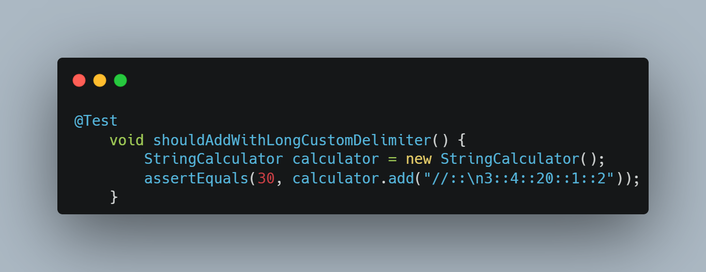
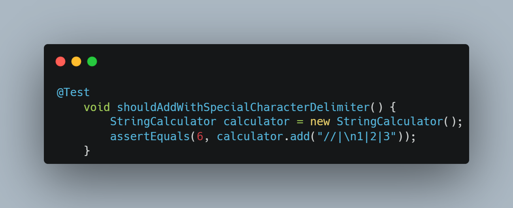
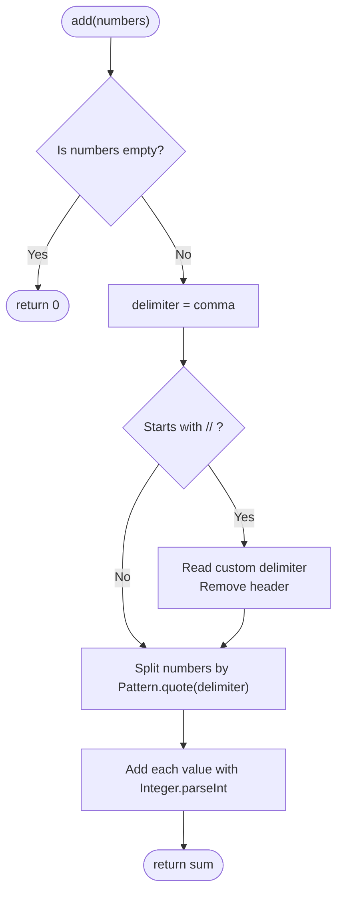

<h1 align="center">NEXT DIGITAL - TDD - STRINGCALCULATOR</h1>

  

  
  

  <b>Miguel González Moreno</b> · <b>Mario Coronado López</b>

---

## Description

**String Calculator** kata solved with **TDD**: an `add(String)` method that sums the numbers in a string, separated by commas or by a custom delimiter using the format `//[delimiter]\n[numbers...]`.

---

## Tests Used

### `shouldReturnZeroWhenEmpty`
Empty string → `0`.

### `shouldReturnTheSameNumber`
Single number → same number.

### `shouldAddManyNumbers`
Comma-separated numbers → their sum.

### `shouldAddWithLongCustomDelimiter`
Multi-character delimiter (`::`) → their sum.

### `shouldAddWithSpecialCharacterDelimiter`
Regex special character delimiter (`|`) → their sum.

---

## How it works

